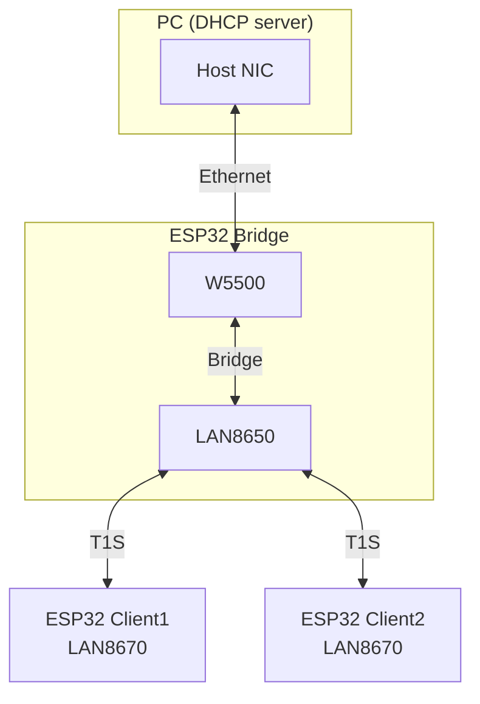

# LAN86xx Bridge Test App

The T1S test app is composed of bridged Ethernet ports (W5500 to the PC, LAN8650 on T1S) and forwards L2 between them. The clients use LAN8670, get DHCP through the bridge, and expose an `iperf` console. It validates the ability to reach all the boards in the loop, verifies the throughput, and tests the PLCA feature.



Serial ports, in order bridge | client1 | client2. Override with `--port`.

## Build

```bash
idf.py -B build_esp32_lan8650_bridge \
  -D SDKCONFIG=build_esp32_lan8650_bridge/sdkconfig \
  -D SDKCONFIG_DEFAULTS="sdkconfig.defaults;sdkconfig.ci.lan8650_bridge" \
  build

idf.py -B build_esp32_lan8670_client1 \
  -D SDKCONFIG=build_esp32_lan8670_client1/sdkconfig \
  -D SDKCONFIG_DEFAULTS="sdkconfig.defaults;sdkconfig.ci.lan8670_client1" \
  build

idf.py -B build_esp32_lan8670_client2 \
  -D SDKCONFIG=build_esp32_lan8670_client2/sdkconfig \
  -D SDKCONFIG_DEFAULTS="sdkconfig.defaults;sdkconfig.ci.lan8670_client2" \
  build

idf.py -B build_esp32_lan8650_bridge_plca \
  -D SDKCONFIG=build_esp32_lan8650_bridge_plca/sdkconfig \
  -D SDKCONFIG_DEFAULTS="sdkconfig.defaults;sdkconfig.ci.lan8650_bridge_plca" \
  build

idf.py -B build_esp32_lan8670_client1_plca \
  -D SDKCONFIG=build_esp32_lan8670_client1_plca/sdkconfig \
  -D SDKCONFIG_DEFAULTS="sdkconfig.defaults;sdkconfig.ci.lan8670_client1_plca" \
  build
```

## Run

```bash
pytest pytest_lan86xx_bridge.py \
  --target all \
  --embedded-services esp,idf,serial \
  --port='/dev/ttyUSB0|/dev/ttyUSB1|/dev/ttyUSB2'
```

## Tests

| Test | What it does |
|------|----------------|
| `test_lan86xx_bridge` | Ping between host, bridge and both clients, then PC to each client iperf (TCP and UDP, one at a time) |
| `test_lan86xx_client1_iperf` | PC to client1 iperf only (TCP and UDP) |
| `test_lan86xx_bridge_iperf_parallel` | PC to both clients iperf at the same time |
| `test_lan86xx_dut_to_dut_iperf` | client2 to client1 iperf over T1S |
| `test_lan86xx_plca_multi_ids` | Both clients send iperf UDP to the PC, client1 has four PLCA transmit opportunities, client2 has one |

The DUT `iperf` command comes from `espressif/iperf-cmd`. Pass/fail limits are in `pytest_lan86xx_bridge.py`.

## Expected Outcome

```
I (416) lan86xx_bridge: Bridge up: 2 Ethernet port(s)
I (25786) lan86xx_bridge: PING_RESULT <ip> OK rx=3/3

INFO  client1 PC->client1 TCP throughput (DUT receive): 4.86 Mbits/s
INFO  client1 PC->client1 UDP throughput (DUT receive): 5.71 Mbits/s
INFO  client2 PC->client2 TCP throughput (DUT receive): 4.83 Mbits/s
INFO  client2 PC->client2 UDP throughput (DUT receive): 5.71 Mbits/s
INFO  parallel TCP DUT receive: client1=2.42, client2=2.43, sum=4.85 Mbit/s
INFO  parallel UDP DUT receive: client1=2.99, client2=2.73, sum=5.72 Mbit/s
INFO  client2->client1 TCP DUT receive (server side): 8.40 Mbits/s
INFO  client2->client1 UDP DUT receive (server side): 9.02 Mbits/s
INFO  PLCA slots client1=4 (ids 1,3,5,7) client2=1 (id 2): host recv client1=3.51 client2=1.77 ratio=1.98 (need >= 1.40)

======================== 5 passed =========================
```